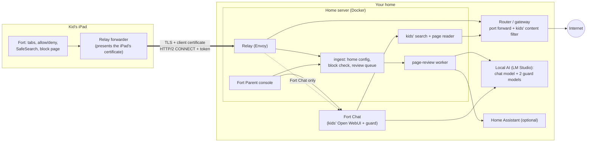
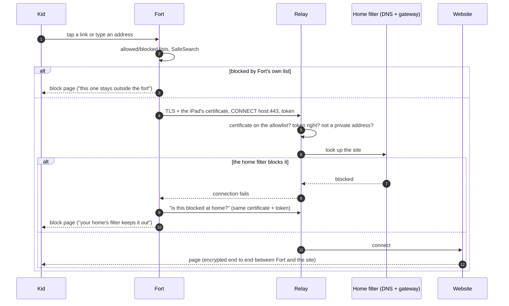

# How Fort fits together

Fort is a kids' web browser for iPad that can be tied to **your own home network**. On its own it's a filtered browser. Add the pieces below and it becomes a small family system, run entirely on hardware you own:

| Piece | What it adds | Guide |
|---|---|---|
| **Fort** (the app) | A browser with a PIN-protected parent area: allowed/blocked sites, strict SafeSearch, favorites, a friendly block page. | [Fort on its own](fort-app.md) |
| **The relay** | Every page goes through your home, so your home network's filter applies wherever the iPad is. Only your family's iPads can use it (each has its own certificate). If home can't be reached, Fort doesn't browse. | [The relay](relay.md) |
| **Home config** | Change favorites, blocked sites and more on every iPad from home. | [Home config](home-config.md) |
| **Page review** | A local AI reads the pages your kids visit and tells you about anything worrying. | [Page review](page-review.md) |
| **Fort Chat** | A chat helper for kids (homework, stories, "what rock is this?") on your own AI hardware, with two safety models checking every message and reply. | [Fort Chat](fort-chat.md) |
| **Fort Parent** | A console for you: each kid's browsing and chats, and the home config editor. Sign-in with passkeys. | [Fort Parent](parent-console.md) |

Each layer is optional and builds on the one before. Nothing in it phones home to anyone but you: no accounts, no subscription, no telemetry.

## Architecture

## What happens when a kid opens a page

The relay only sees which site and how much data, not the pages: those stay encrypted between Fort and the website. Home filtering applies because the relay's lookups and connections are the ones your network sees.

## Security design

**Goals:** only your family's iPads can use the relay; a stolen password or relay address alone gets nobody in; the relay can't be used to reach your home network; any failure means no browsing, never unfiltered browsing; activity data stays at home.

| Threat | Control |
|---|---|
| Strangers using your relay | Mutual TLS: without a certificate from your family's own CA, listed on the allowlist, there's no connection at all. A token is a second check. |
| A lost iPad | Remove its line from the allowlist (no restart). Certificates expire after 2 years. |
| A leaked token | Useless without a certificate; rotate it in one command. |
| The relay as a way into your LAN | The relay refuses private addresses, bare IP addresses, your own domains and other ports. Underneath, put it on its own VLAN with firewall rules ([guide](relay.md#7-isolate-it-on-its-own-vlan)). |
| A kid getting around the filter | Fort fails closed (no direct fallback), refuses bare IPs (so DNS filtering can't be skipped), and links from other apps go through the same checks. Screen Time hides Safari and blocks app installs. |
| Fort Chat saying something it shouldn't | Two safety models check every message and reply; unchecked text never reaches the screen; if a check fails, nothing is shown. Web results and linked pages are checked before the model sees them. See [Fort Chat](fort-chat.md#limits) for what this can't guarantee. |
| Someone reading the kids' activity | Fort Parent uses passkeys only; the kids' network is refused at the reverse proxy. |
