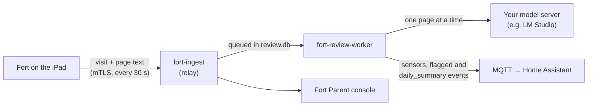

# Page review

A local AI model reads the pages your kids visit (address, title and the first part of the text), labels each one, and tells you about anything worrying, with a short daily summary. Needs [the relay](relay.md). Nothing goes to any cloud service: the iPad sends pages to your relay, and the relay asks a model running on your own hardware.

## How it works



1. After each page finishes loading, Fort records the address, the title (first 300 characters) and the page's visible text (first 2,000 characters). It uploads these in batches to the relay's `/fort/ingest`, signed with the iPad's client certificate, so the relay knows which iPad sent them. Without page review turned on, only the address, title and whether it was allowed are sent.
2. `fort-ingest` stores each visit in `server/relay/review/review.db` (SQLite). Pages that came with text are queued for review.
3. `fort-review-worker` takes queued pages a few at a time and asks the model for a verdict: a **category**, a **concern level** and a one-line **summary**. The answer is forced into a fixed JSON shape (structured output), with a lenient fallback parser for servers that ignore that.
4. A concern of 2 or more raises a `flagged` event right away. Once a day (at `REVIEW_SUMMARY_AT`) each iPad gets a `daily_summary` event: pages visited, top sites, blocked count and anything flagged.

### Categories and concern levels
Categories: `ok`, `adult`, `violence`, `self_harm`, `drugs_alcohol`, `hate`, `gambling_scams`, `mature_other`.

| Concern | Meaning |
|---|---|
| 0 | Fine for a child of `REVIEW_CHILD_AGE` |
| 1 | Mildly mature |
| 2 | A parent should know (sends `flagged`) |
| 3 | Urgent: sexual content, self-harm, contact from strangers, grooming (sends `flagged`) |

The prompt tells the model that ordinary news, games, school, shopping and video sites are usually 0 or 1, and not to flag pages just for their ads. It's in `server/relay/worker.py` (`PROMPT`) if you want to tune it.

## What you need
- An OpenAI-compatible chat-completions server on your network, e.g. [LM Studio](https://lmstudio.ai/) with "Serve on Local Network" on, or Ollama, llama.cpp's server or vLLM. We use **Gemma 4 31B** (`gemma-4-31b-it`). Any capable instruction model works; smaller ones flag more ordinary pages. The model must stay loaded: with LM Studio, turn off idle unloading (or set a long TTL) so it's there when pages arrive.
- The relay's Docker host must be able to reach that server. If the relay is on an isolated VLAN ([relay guide](relay.md#7-isolate-it-on-its-own-vlan)), allow the relay's address to the model server's port.
- Optional: Home Assistant with an MQTT broker, for sensors and alerts. Without MQTT the verdicts still land in the database and in [Fort Parent](parent-console.md).

## Turn it on
1. In the relay's `.env`:
   - add `review` (and `monitoring`, if you want relay health sensors too) to `COMPOSE_PROFILES`;
   - set `LLM_URL` (the full `/v1/chat/completions` address), `LLM_MODEL` (the model name the server expects) and `MQTT_HOST` (plus `MQTT_PORT` if it isn't 1883);
   - optionally `REVIEW_CHILD_AGE` (default 9; one age for all iPads), `REVIEW_SUMMARY_AT` (daily summary time, the Docker host's local time, default `19:30`) and `REVIEW_RETENTION_DAYS` (default 30).
2. `docker compose up -d`.
3. Turn on **page review** per iPad (Parent settings › *Send page text home for review*), or for every iPad from [home config](home-config.md) with `"reviewPages": true`.

Consider telling your kids. Fort doesn't hide that it reports home, and it works better as a known rule than as a secret.

## What you get
- **In Home Assistant** (MQTT discovery, under the device *Fort review*):
  - `event.fort_review`, with event types `flagged` and `daily_summary`;
  - per iPad, `sensor.fort_review_<ipad>_pages` (*pages today*) and `sensor.fort_review_<ipad>_flagged` (*flagged today*). `<ipad>` is the device ID from its certificate, lowercased with `_` for punctuation (e.g. `kid1-ipad` → `kid1_ipad`).
- **In [Fort Parent](parent-console.md):** every visit, block and flag, per kid.

### The events
A `flagged` event carries `device`, `concern`, `category`, `summary`, `url`, `title` and `ts`. A `daily_summary` event carries `device`, `message` (one ready-to-send line), `pages` and `flagged`.

### Example: phone alerts
```yaml
automation:
  - alias: Fort review — notify
    mode: queued
    trigger:
      - platform: state
        entity_id: event.fort_review
    condition:
      # Skip the state changes when the entity goes unavailable or comes back.
      - condition: template
        value_template: "{{ trigger.to_state.attributes.event_type in ['flagged', 'daily_summary'] }}"
    action:
      - variables:
          e: "{{ trigger.to_state.attributes }}"
      - service: notify.mobile_app_your_phone
        data:
          title: >-
            {{ 'Fort: ' ~ e.device ~ (' flagged a page' if e.event_type == 'flagged' else ' today') }}
          message: >-
            {{ e.category }} (concern {{ e.concern }}): {{ e.summary }} — {{ e.url }}
            {{ e.message }}
          data:
            # iOS: urgent flags break through Focus.
            push:
              interruption-level: "{{ 'time-sensitive' if e.event_type == 'flagged' and e.concern >= 3 else 'active' }}"
```

## Check it works
1. `docker compose logs -f worker` shows `connected to MQTT`.
2. Browse a page or two on an iPad with page review on. Within a minute the *pages today* sensor goes up.
3. To see a flag end to end, browse to a news article about a crime or a drug bust: it usually gets concern 1–2. Its verdict is in the console's activity view.
4. Ask the model server directly, from the relay host, if nothing gets classified:
   `curl -s $LLM_URL -H 'Content-Type: application/json' -d '{"model":"<LLM_MODEL>","messages":[{"role":"user","content":"hi"}]}'`

## Troubleshooting
- **`classify failed … Connection refused` / timeouts in the worker log:** the model server is down, unloaded or unreachable from the relay. The worker waits 2 minutes and tries again, and pages stay queued. A page that fails 10 times is set aside as `failed` and won't be retried.
- **`unusable answer`:** the model replied without valid JSON. After 3 such answers the page is set aside. Use a server that supports `response_format` with a JSON schema (LM Studio does), or a stronger model.
- **Too many flags on harmless pages:** use a bigger model, raise `REVIEW_CHILD_AGE`, or adjust `PROMPT`.
- **No sensors in Home Assistant:** check `MQTT_HOST`/`MQTT_PORT`, that the broker allows the relay's connections (the worker connects anonymously), and that MQTT discovery is on. An iPad's sensors appear after its first visit reaches the relay.
- **Daily summary missing:** it's sent once a day at `REVIEW_SUMMARY_AT`, only for iPads with visits that day. If the worker starts after that time, it waits until the next day.

## Privacy
Page text and titles are deleted after `REVIEW_RETENTION_DAYS` (default 30); visit records after a year. The data stays in `server/relay/review/` on your server, and only goes to the model server you set in `LLM_URL`. Back up or delete that directory like any other family data.
